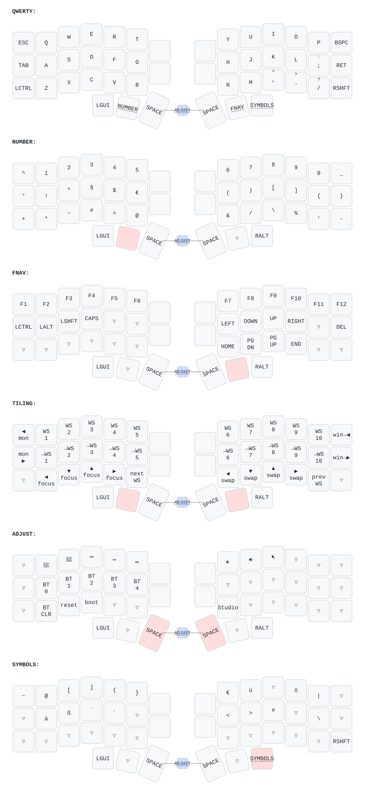

# Corne Choc Pro Keymap

Personal ZMK firmware config for the **Corne Choc Pro** — a 42-key wireless split keyboard with low-profile Choc switches and `nice_view` screens. Made for software development on **Hyprland (Omarchy 4.5.0)** with the **German system layout (`de`)**: QWERTY letters as on the keycaps, German characters through German key codes, tiling keys for Hyprland.

The image above is regenerated on every push to `main` by the [`draw-keymap`](.github/workflows/draw-keymap.yml) workflow using [keymap-drawer](https://github.com/caksoylar/keymap-drawer); its labels are in [`keymap_drawer.config.yaml`](keymap_drawer.config.yaml).

## How the German layout works

The computer uses its normal system layout `de` (`XKBLAYOUT=de`); there is no per-device override and no remapping tool. The firmware sends **German key codes** (`DE_*` from [`config/keys_de.h`](config/keys_de.h)), so the character that is meant is the character that arrives. A key code names a character, not a position: `DE_Y` is sent as the HID usage the German layout reads as `y`.

- **Letters:** QWERTY as on the keycaps — `Y` on the top row, `Z` on the bottom row (the Z-X-C-V block stays together for Ctrl+Z/X/C/V).
- **US legends on the base layer:** `; :`, `, <`, `. >` and `/ ?` are mod-morphs: the key sends the first character, with Shift the second one.
- **Dead keys:** `^`, `´` and `` ` `` are dead keys of the German layout. Their keys send the character **and a Space**, so it appears at once.
- **Header:** `config/keys_de.h` is a copy of the German header of [joelspadin/zmk-locales](https://github.com/joelspadin/zmk-locales) (commit and license in the file's first comment).

## Layer reference

| # | Layer    | Activation                                  | Purpose                                                                 |
|---|----------|---------------------------------------------|-------------------------------------------------------------------------|
| 0 | QWERTY   | default                                     | QWERTY letters, US legends for `; : , < . > / ?`                        |
| 1 | NUMBER   | hold left middle thumb (**Lower**)          | digits, `^ ° ! " § $ €`, brackets `( ) [ ] { }`, `+ * ~ # = @ & / \ % ' - _` |
| 2 | FNAV     | hold right middle thumb (**Raise**)         | F1–F12, arrows, Home/End/PgUp/PgDn, Strg/Alt/Shift/Caps, Entf           |
| 3 | TILING   | hold **Lower + Raise** together             | Hyprland: workspaces, window focus and swap, monitors                   |
| 4 | ADJUST   | **Left Space + Right Space** together       | media, brightness, Bluetooth profiles, reset, bootloader, Studio unlock |
| 5 | SYMBOLS  | hold right outer thumb                      | `ä ö ü ß €`, developer characters `@ # \| \ ~ < > [ ] { }`, dead keys grave and acute |

Thumb keys: left `Super` · `Lower` · `Space`, right `Space` · `Raise` · `Symbols`.

### Umlauts, ß and developer characters (SYMBOLS)

| Char | Key (with SYMBOLS held) | Char | Key                    |
|------|-------------------------|------|------------------------|
| `ä`  | `A` position            | `@`  | `Q` position           |
| `ö`  | `O` position            | `~`  | `Esc` position         |
| `ü`  | `U` position            | `\|` | `P` position           |
| `ß`  | `S` position            | `\`  | `;` position           |
| `€`  | `Y` position            | `#`  | `K` position           |
| `<` `>` | `H` / `J` position  | `[ ] { }` | `W E R T` positions |
| `` ` `` `´` | `D` / `F` position (dead keys, sent with a Space) | | |

Capital umlauts: hold Shift. The same characters are also on NUMBER (brackets, `@`, `~`, `#`, `\`, `€`, …).

### Tiling layer (Hyprland, Omarchy 4.5.0)

Every monitor has its own block of ten workspaces (laptop 1–10, LG 11–20); `Super+1…0` acts on the block of the focused monitor.

| Row    | Left half                                              | Right half                                  |
|--------|--------------------------------------------------------|---------------------------------------------|
| Top    | `Esc` pos. `Super+Ctrl+←` (focus monitor left); `Q W E R T` → `Super+1..5` | `Y U I O P` → `Super+6..0`; `Backspace` pos. `Super+Ctrl+Shift+←` (window to the monitor on the left) |
| Middle | `Tab` pos. `Super+Ctrl+→` (focus monitor right); `A S D F G` → `Super+Shift+1..5` (window to workspace) | `H J K L ;` → `Super+Shift+6..0`; `Enter` pos. `Super+Ctrl+Shift+→` (window to the monitor on the right) |
| Bottom | `Z X C V` → `Super+←↓↑→` (focus window); `B` → `Super+Tab` (next workspace) | `N M , .` → `Super+Shift+←↓↑→` (swap window); `/` → `Super+Shift+Tab` (previous workspace) |

The other Omarchy keys (`Super+Enter` terminal, `Super+W` close, `Super+F` full screen, `Super+T` floating, `Super+Space` menu) are on the base layer: hold the left thumb (Super) and press the key.

## Bluetooth profiles

The board holds up to 5 paired hosts. Profile selection is on the **ADJUST layer** (Left Space + Right Space):

| Key (ADJUST layer position) | Action                                                    |
|-----------------------------|-----------------------------------------------------------|
| `A` … `G` (middle row)      | `BT 0` … `BT 4`: switch to Bluetooth profile 0–4          |
| `Z` (`BT CLR`)              | clear the bond of the active profile                      |
| `X` (`reset`)               | `sys_reset`: restart the controller                       |
| `C` (`boot`)                | `bootloader`: enter the UF2 bootloader for flashing       |

This keyboard is paired with one computer (profile 0). To pair again: select the profile, run `BT CLR`, remove the old entry on the host, then pair from the host's Bluetooth settings.

## ZMK Studio

Studio is built into the left half (the split central) only: `studio-rpc-usb-uart` snippet and `CONFIG_ZMK_STUDIO` in [`build.yaml`](build.yaml). The unlock key `&studio_unlock` is on the **ADJUST layer**, first key of the bottom row on the right half.

**The repository is the truth.** Use Studio only to try things out. Once Studio has saved a keymap on the keyboard, it takes precedence over the `.keymap` in the firmware, so a flashed firmware with a changed `.keymap` does not show the change: **before changing the `.keymap`, use "Restore Stock Settings" in Studio** (or flash the `settings_reset` image). Studio cannot add layers beyond those in the keymap; a layout made in Studio is lost on the next `settings_reset`.

## Building and flashing

Firmware builds run on every push through the [`build`](.github/workflows/build.yml) workflow (ZMK `v0.3`). The Corne's artifacts are `nice_view-corne_choc_pro_{left,right}-zmk.uf2` and `settings_reset-corne_choc_pro_{left,right}-zmk.uf2`.

1. Put the half into the bootloader: double-press the controller's reset button (or press `boot` on the ADJUST layer). A `KEEBART` (or `NICENANO`) drive mounts.
2. Copy the matching `.uf2` file to the drive. The half reboots when the copy completes.
3. Repeat for the other half.

**Resetting the pairing** (lost bonds, split halves that do not find each other, a layout left behind by Studio): flash `settings_reset-corne_choc_pro_left-zmk.uf2` to the left half and `…_right…` to the right half, then flash the two `nice_view` images (left first), switch both halves on, pair profile 0 with the computer. The reset image only wipes the stored settings — a half with only the reset image has no keyboard firmware.

## Repository

| Path | Content |
|------|---------|
| `config/corne_choc_pro.keymap` | the keymap used by the build |
| `config/keys_de.h` | German key codes (copy of zmk-locales, see the file) |
| `config/west.yml` | ZMK `v0.3` |
| `boards/arm/corne_choc_pro/` | board definition (the keymap in this folder is overridden by `config/`) |
| `build.yaml` | build matrix (Corne Choc Pro, Piantor Pro BT, Sofle Choc Pro) |
| `keymap.yaml`, `keymap.svg` | generated by `draw-keymap` |
| `docs/` | cheatsheet (German) and board documentation |
